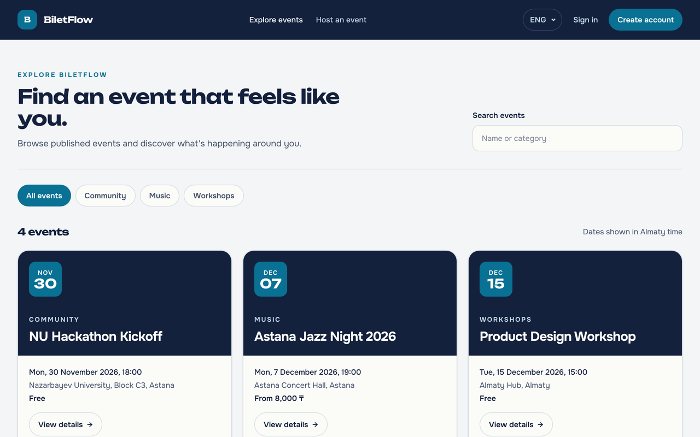
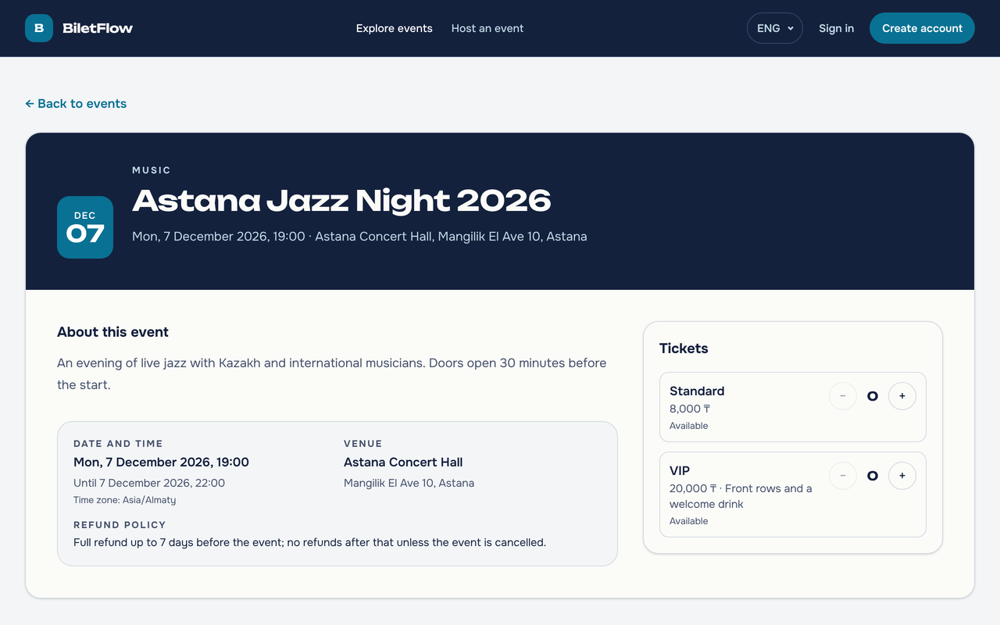
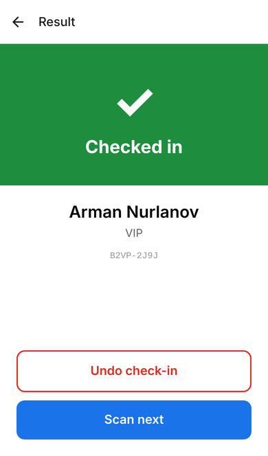
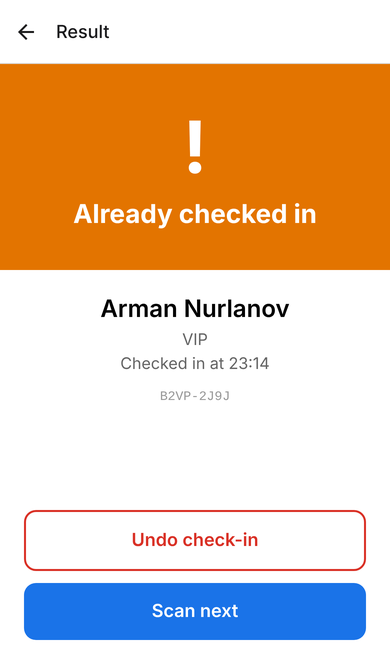
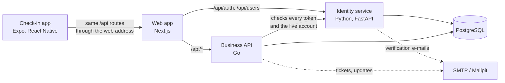

# BiletFlow

**Self-service event ticketing for Kazakhstan.** Organizers publish events and sell tickets,
attendees buy them and get a QR ticket, and door staff check people in with a mobile app.
One ticket, one entry: a repeated check-in is always rejected.

Built by team **404 Found** for CSCI 361 (Fall 2026), from the BiletFlow SRS (initial draft).

<p>
  
  
</p>
<p>
  
  
</p>

## Contents

- [Features](#features)
- [Architecture](#architecture)
- [Tech stack](#tech-stack)
- [Repository structure](#repository-structure)
- [Getting started](#getting-started)
- [Testing](#testing)
- [Documentation](#documentation)
- [Known limitations](#known-limitations)
- [Team and contributions](#team-and-contributions)
- [How we worked](#how-we-worked)

## Features

**Attendees**
- Browse published events and open an event page with dates, venue, refund policy and tickets.
- Register for free events, or buy paid tickets with a short hold timer and a **simulated** card
  payment (a declined card creates no tickets and releases the hold).
- Get tickets by e-mail and in the account: PDF tickets with a **signed QR code**.
- See orders, cancel free registrations, and open support cases from an event, order or ticket.
- Apply promo codes, including by scanning a **campaign QR code** that opens the event with the
  discount checked on the server.

**Organizers**
- Create, edit, preview, duplicate, publish, unpublish, cancel and delete events.
- Add free and paid ticket types with prices, quantities and sales windows.
- Activate paid sales per event: terms, a simulated identity and payout check, and an activation fee.
- Run promo campaigns, add door staff (with or without permission to undo), issue refunds.
- See orders, analytics (sales, capacity, campaigns, attendance) and an append-only event timeline
  that can be filtered by date and activity type.

**Door staff (check-in app)**
- Sign in and see only the events they work at, with live counts.
- Scan a ticket QR: the server checks its signature and admits it once. Results fill the screen:
  checked in, already used (with the time), cancelled, refunded, wrong event, not a ticket
  (campaign QR), invalid, check-in closed, or no connection.
- Search attendees by name, ticket code or order number; undo a check-in where allowed.
- Online only: without a connection nobody is admitted.

**Platform admins**
- Moderate events (suspend, resume, stop paid sales), review reports, users, orders, payments,
  activations and promo activity, change settings such as the activation fee, and export reports.

**Everywhere**
- Kazakh, Russian and English in the web app, the check-in app and the ticket e-mails.
- Role-based access: attendee, organizer, event admin (door staff) and platform admin.
- The web app meets WCAG 2.1 AA colour contrast and works on phone-sized screens.

## Architecture



- The **identity service** owns accounts, sign-in, roles and organizer profiles, and signs
  RS256 JWTs. Only it holds the private key.
- The **business API** owns events, tickets, checkout, check-in, promo, support, analytics and
  administration. It verifies each token's signature and confirms the account is still active.
- The **web app** routes `/api/auth` and `/api/users` to the identity service and everything else
  to the business API, so the check-in app needs only one address.
- Design decisions (including why there are two backends) are recorded in
  [docs/architecture.md](docs/architecture.md).

## Tech stack

| Part | Technology | Folder |
|---|---|---|
| Identity service | Python 3.12, FastAPI, SQLAlchemy, Alembic, Argon2id | `backend-python/` |
| Business API | Go, standard `net/http`, PostgreSQL (`lib/pq`) | `backend-go/` |
| Web app | Next.js, React, TypeScript, Tailwind CSS | `frontend/` |
| Check-in app | Expo, React Native, TypeScript | `mobile/` |
| API contract | OpenAPI 3 (`docs/openapi.yaml`), generated TypeScript types | `docs/` |
| Database | PostgreSQL 16 | |
| E-mail (local) | Mailpit | |
| Tests | pytest, Go `testing`, Jest, Playwright | |
| CI | GitHub Actions | `.github/workflows/` |
| Deployment | Docker Compose, optional local HTTPS (nginx) | `compose.yaml`, `deploy/` |

## Repository structure

```text
SWE/
├── backend-python/   Identity service (accounts, sign-in, roles)
├── backend-go/       Business API (events, tickets, checkout, check-in, admin)
├── frontend/         Web app
├── mobile/           Door check-in app
├── e2e/              End-to-end browser tests for the web app and the check-in app
├── scripts/          Local setup, demo data and smoke tests
├── deploy/           Local HTTPS setup
├── docs/             Architecture, API contract, data model
├── compose.yaml      Local stack
├── CONTRIBUTING.md   Branch and pull-request rules
└── README.md
```

## Getting started

**Requirements:** Docker Desktop, Python 3.12, Node.js 24.

```bash
python3 scripts/init_local.py                       # secrets and .env, once
docker compose up --build -d python go mailpit      # identity, business API, test mailbox
python3 scripts/seed_demo.py                        # demo events, orders and accounts
docker compose exec python python -m app.cli set-role admin@biletflow.kz --role platform_admin
cd frontend && npm install && npm run dev           # http://localhost:3000
```

E-mails (verification links and tickets) arrive in Mailpit at http://localhost:8025.

The demo data loads 3 published events, 1 draft, orders, a promo campaign, door staff and a
support case. Its accounts are for local development only and share the password `demo12345`:

| Account | Role |
|---|---|
| `aigerim@example.kz` | attendee (Kazakh) |
| `arman@example.kz` | attendee (Russian) |
| `organizer@biletflow.kz` | organizer of the demo events |
| `staff@biletflow.kz` | door staff for Jazz Night (can undo) and the Hackathon |
| `admin@biletflow.kz` | platform admin |

**Check-in app:** see [mobile/README.md](mobile/README.md). On a phone with Expo Go, point it at
your computer's LAN address, for example `EXPO_PUBLIC_API_URL=http://192.168.1.10:3000 npx expo start`.

### More setup options

- Identity service on its own (migrations, health checks, tests):
  [backend-python/README.md](backend-python/README.md).
- Token handling between the two backends: [docs/python-go-auth.md](docs/python-go-auth.md).
- **Local HTTPS** with Docker Desktop running and ports 8443 and 8025 free:

  ```sh
  python3 scripts/init_local.py
  python3 scripts/init_tls.py
  docker compose -p biletflow-integrated -f compose.yaml -f deploy/compose.https.yaml up --build -d --wait
  ```

  Open https://localhost:8443 and Mailpit at http://localhost:8025. For browser trust, import only
  the local public CA at `.secrets/tls/ca.crt`. This separate Compose project has its own database
  volume; stop the other stack first if it uses either port. To make a verified account a platform
  admin:

  ```sh
  docker compose -p biletflow-integrated -f compose.yaml -f deploy/compose.https.yaml exec python \
    python -m app.cli set-role admin@example.com --role platform_admin
  ```

  Sign in again after the role change. Organizers add door staff on the event's Staff tab, and
  language preferences are saved under Account.

## Testing

Every pull request runs these checks in GitHub Actions.

| Part | Command | What it covers |
|---|---|---|
| Identity service | `pytest backend-python/tests` (needs `TEST_DATABASE_URL` to a database ending in `_test`) | Registration, verification, sign-in, roles, profiles, admin users |
| Business API | `cd backend-go && go test -race ./...` (needs `GO_TEST_DATABASE_URL`) | Events, checkout, concurrency (no overselling), check-in, promo, support, admin |
| API contract | `npm run api:lint` and `npm run api:types` | The OpenAPI file is valid and the generated types are up to date |
| Integration | `python scripts/smoke_identity.py`, `python scripts/smoke_integration.py` | Real e-mail flow and Python ↔ Go token checks against the running stack |
| Web app | `cd frontend && npm run typecheck && npm run build` | Types and production build |
| Check-in app | `cd mobile && npm run typecheck && npm test && npm run i18n:check` | Types, unit tests, every phrase translated |
| End to end | see [e2e/README.md](e2e/README.md) | 18 browser tests on the whole running product |

The end-to-end tests buy a ticket in Kazakh (declined card, then success), open every organizer
and admin tab, scan every page in Kazakh and Russian for leftover English, and run the check-in
app with a fake camera showing a real ticket QR: the first scan is admitted, the second is refused.

## Documentation

| Document | Contents |
|---|---|
| [docs/architecture.md](docs/architecture.md) | Architecture decisions (ADRs), security boundary |
| [docs/api-contract.md](docs/api-contract.md) | Shared API contract and implementation status |
| [docs/openapi.yaml](docs/openapi.yaml) | Full OpenAPI specification |
| [docs/erd.md](docs/erd.md) | Identity and event data model |
| [docs/python-go-auth.md](docs/python-go-auth.md) | Authentication between the two backends |
| [mobile/README.md](mobile/README.md) | Check-in app |
| [e2e/README.md](e2e/README.md) | End-to-end tests |
| [CONTRIBUTING.md](CONTRIBUTING.md) | Branches, pull requests, what never to commit |

## Known limitations

- **Payments, payouts and identity checks are simulated.** No real money moves.
- **Check-in is online only.** Offline scanning is out of scope for the academic MVP.
- **Not built (SRS bonus features):** assigned seating with a seat map, calendar (.ics) export,
  and GA4 analytics.
- **Backups:** automated database backups with a tested restore are not set up yet.
- **Two backends:** the SRS suggests one primary backend; the exception is documented in
  [ADR 001](docs/architecture.md) and still needs the instructor's approval.
- Account verification e-mails from the identity service are in English only.
- Kazakh texts should be reviewed by a native speaker before a real launch.

## Team and contributions

| Member | Role | Main contributions | Pull requests |
|---|---|---|---|
| **Aliar** ([Nurgissa-A](https://github.com/Nurgissa-A)) | Backend: identity and security, architecture | Repository setup, Python identity service (accounts, verification, roles, organizer profiles), RS256 JWT security between the Python and Go services, backend CI, architecture decisions | #2, #4, #5, #21 |
| **Madi** ([mazhumadi](https://github.com/mazhumadi)) | Backend: business API and database | Go event service, business API (events, checkout, tickets, check-in, promo, support, admin) with its database migrations and tests; reviewed and merged the early backend PRs | #1, #11 |
| **Nurgul** ([bakhtiyarnurgul](https://github.com/bakhtiyarnurgul)) | Web frontend | OpenAPI specification, Next.js app setup, web pages and API integration: sign-in, events, checkout, organizer and admin dashboards, translations | #7, #18 |
| **Aigerim M.** ([Aikookia-n](https://github.com/Aikookia-n)) | Mobile app, requirements and testing | Door check-in app (scanner, search, undo, live counts), its connection to the real API, unit tests, test plan, iPhone and real-backend test runs | #8, #17, #20 |
| **Aigerim Zh.** ([aigerim25102](https://github.com/aigerim25102)) | Project coordination, QA and UI/UX | Team coordination from week 3 (task split, merge order, PR checks, final verification), design system, WCAG 2.1 AA accessibility and phone layouts, end-to-end test suite and its CI, demo data, project README | #10, #19, #22 |

## How we worked

- **Weeks 1–2:** Aliar and Madi set up the repository, the workflow and the first task split.
  Each member then owned one area (identity, business API, web, mobile, design).
- **From week 3:** Aigerim Zh. coordinated the team: dividing tasks, tracking what had to be
  finished against the SRS and the course criteria, and checking pull requests. Each area was built
  on its own feature branch against the shared OpenAPI contract (`docs/openapi.yaml`) and merged
  through pull requests (#1–#7).
- **Verification:** before the demo, every suite was run on the demonstrated commit: 51 identity
  tests, 55 business API tests, 31 check-in app tests and 18 end-to-end tests, all passing.
- **Rules:** see [CONTRIBUTING.md](CONTRIBUTING.md). Never commit `.env`, `.secrets/`, passwords
  or tokens.
