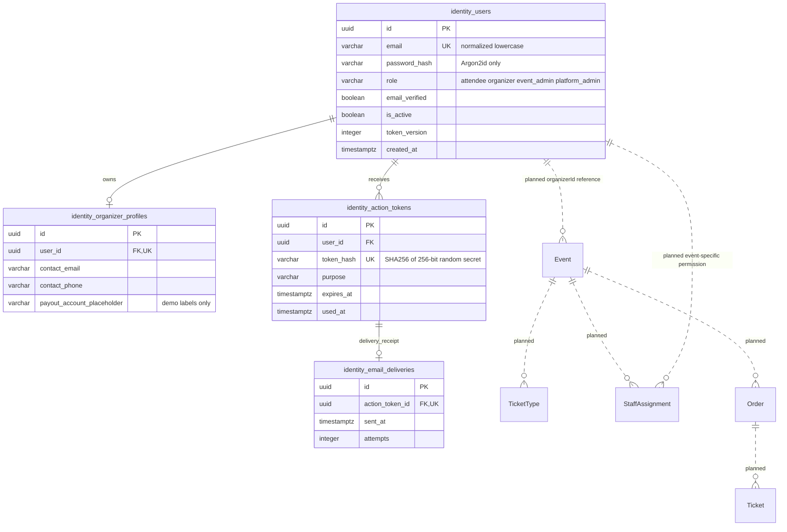

# Identity and Event data model

Python migrations implement the four `identity_` tables below. Go's current `Event` model is in-memory; the Event, StaffAssignment, TicketType, Order and Ticket persistence relationships are **planned and Go-owned**. No Python migration creates them.

A user has one coarse platform role as in the original API schema. Event Admin is not Platform Admin and receives no global event-management permission. Madi must implement scoped staff assignments for check-in later. Go stores immutable Python user UUIDs as references, never copies credentials or writes identity tables. Future Event migrations must select a compatible UUID representation: today's Go Event IDs are 32-character hexadecimal strings, a pre-existing mismatch with OpenAPI's UUID format that this identity PR does not silently rewrite.

Constraints: unique normalized email, one profile per user, restricted deletion of a user with a profile, indexed action-token owner/expiry, unique hashed token, valid role/purpose and nonnegative token version. Timestamps are timezone-aware UTC. Verification/reset tokens are row-locked and consumed in the same transaction as the user update, preventing concurrent reuse.
