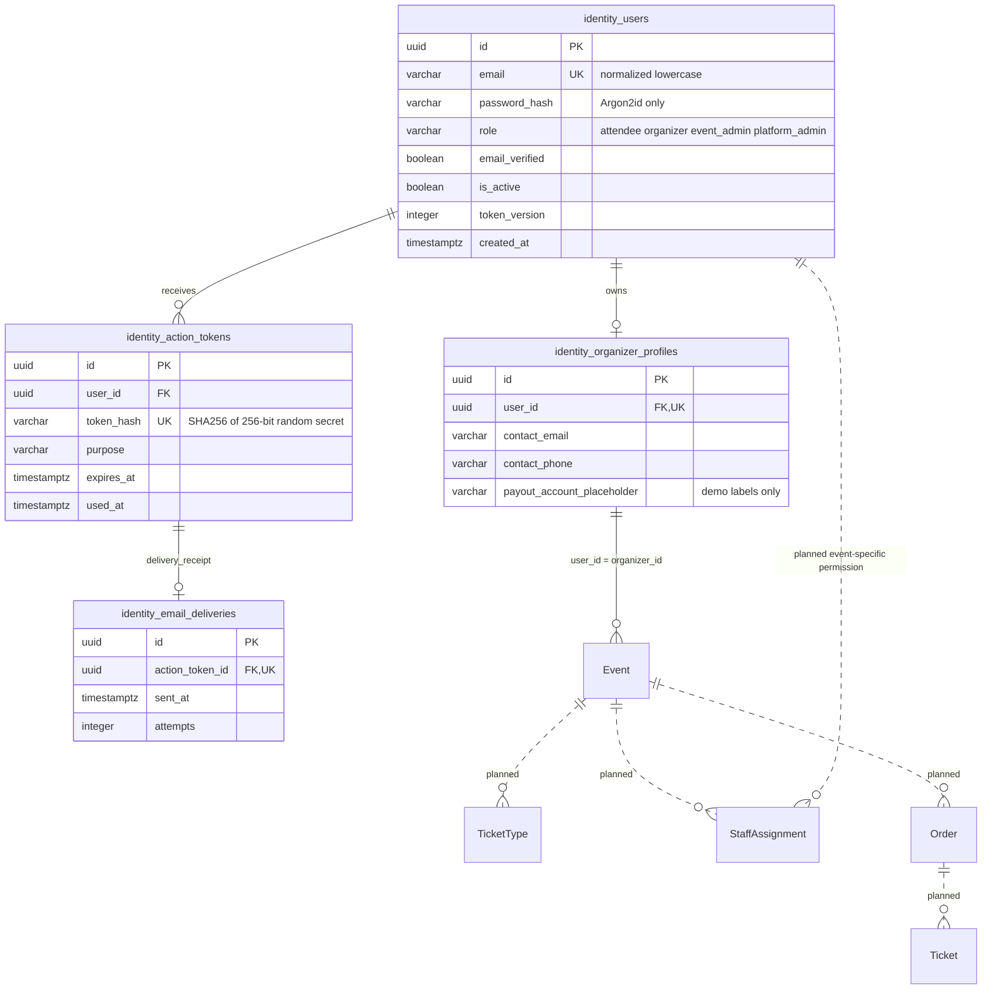
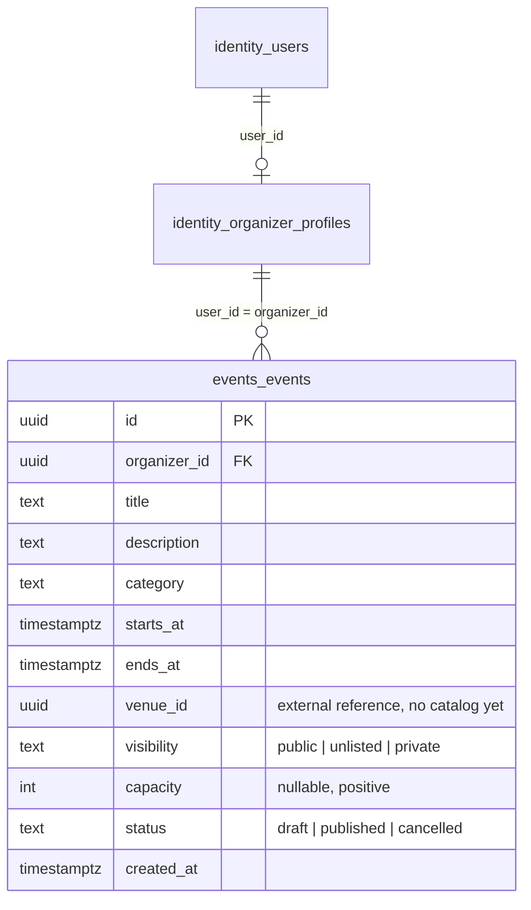

# Identity and Event data model

Python migrations implement the four `identity_` tables below. Go implements Event persistence in its own `events` schema. StaffAssignment, TicketType, Order and Ticket persistence remain planned and Go-owned. No Python migration creates Go tables.

A user has one coarse platform role as in the original API schema. Event Admin is not Platform Admin and receives no global event-management permission. Madi must implement scoped staff assignments for check-in later. Go stores immutable Python user UUIDs as references, never copies credentials or writes identity tables. Go now generates canonical UUID v4 Event IDs and stores them as native PostgreSQL UUIDs, matching OpenAPI.

Constraints: unique normalized email, one profile per user, restricted deletion of a user with a profile, indexed action-token owner/expiry, unique hashed token, valid role/purpose and nonnegative token version. Timestamps are timezone-aware UTC. Verification/reset tokens are row-locked and consumed in the same transaction as the user update, preventing concurrent reuse.

## Go Event implementation (Madi Weeks 1–4)

The runtime now uses **one PostgreSQL database with separate schemas**. Go owns
`events.events` and `events.schema_migrations`; Python retains public
`identity_*` tables and its Alembic ledger. Organizer identity is the Python user
UUID. Event `organizer_id` has a real FK to the unique
`identity_organizer_profiles.user_id`, `ON DELETE RESTRICT`. No Go User or
OrganizerProfile copy exists. Role/active/verification/revocation are checked
against live Python identity for every protected request.

`events_events` in the diagram means SQL `events.events`. UUID v4 keys,
constraints, indexes, transactional migration instructions and extension points
are documented in [Go README](../backend-go/README.md). `venue_id` has UUID
validation, not an invalid FK to an absent table. A future Go TicketType will
reference the Event primary key; no ticket storage is part of Weeks 1–4.
Ticket/Order/Staff relationships in the overview remain planned; only Event storage is implemented.
