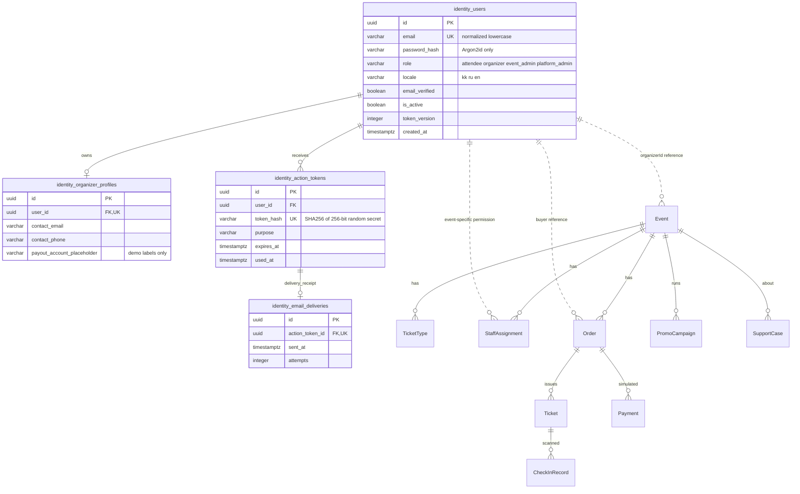

# Identity and Event data model

Python migrations implement the four `identity_` tables below. Go's migrations (`backend-go/internal/platform/migrations`) implement the business tables: events, ticket types, staff assignments, activations, orders, order items, tickets, payments, refunds, promo campaigns and redemptions, check-in records, support cases and messages, notifications, reports, settings and the append-only audit log. Go references identity users by UUID without foreign keys into `identity_` tables; the dotted links below are those references.

A user has one coarse platform role as in the original API schema. Event Admin is not Platform Admin and receives no global event-management permission. Scoped staff assignments (`staff_assignments`) grant check-in for one event only. Go stores immutable Python user UUIDs as references, never copies credentials or writes identity tables. Go Event IDs are now PostgreSQL UUIDs, matching the OpenAPI format.

Constraints: unique normalized email, one profile per user, restricted deletion of a user with a profile, indexed action-token owner/expiry, unique hashed token, valid role/purpose and nonnegative token version. Timestamps are timezone-aware UTC. Verification/reset tokens are row-locked and consumed in the same transaction as the user update, preventing concurrent reuse.
